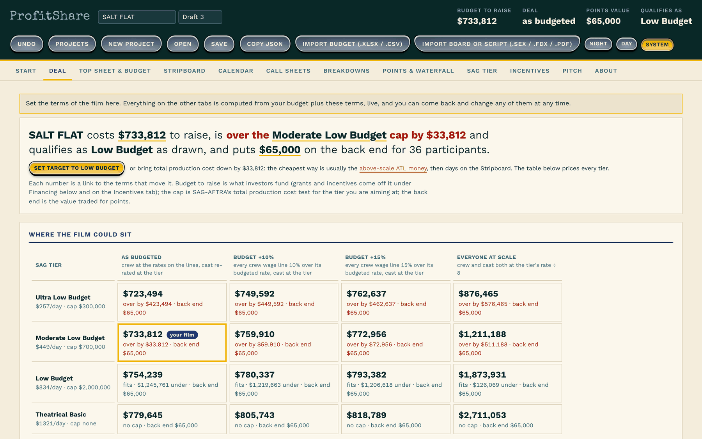
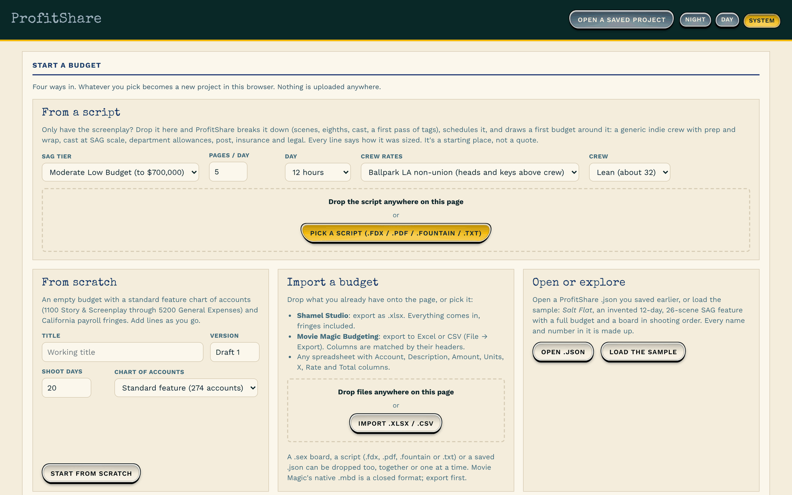
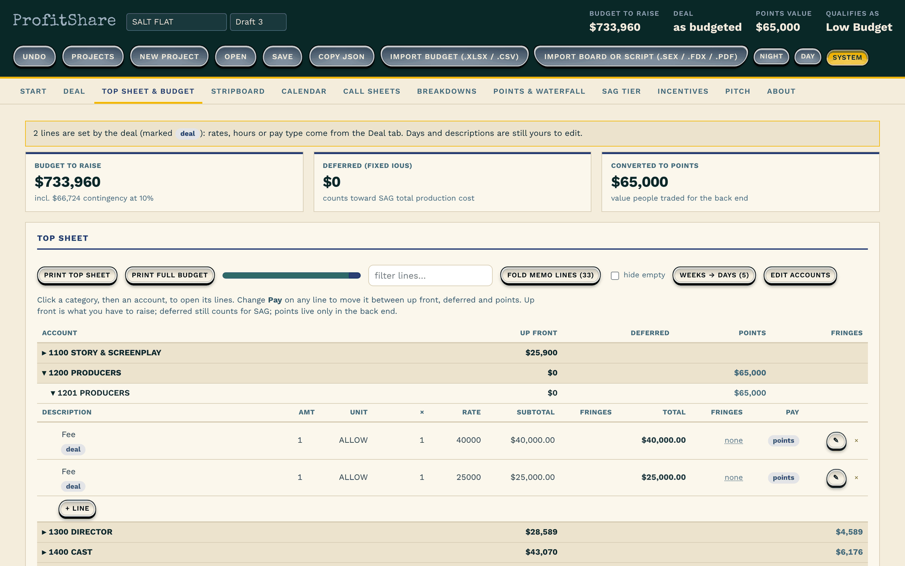
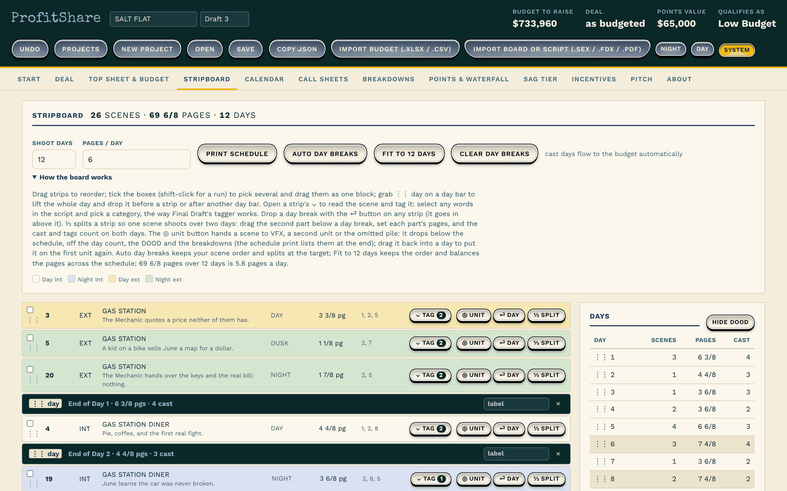
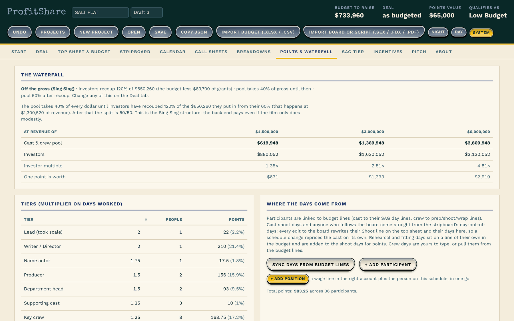
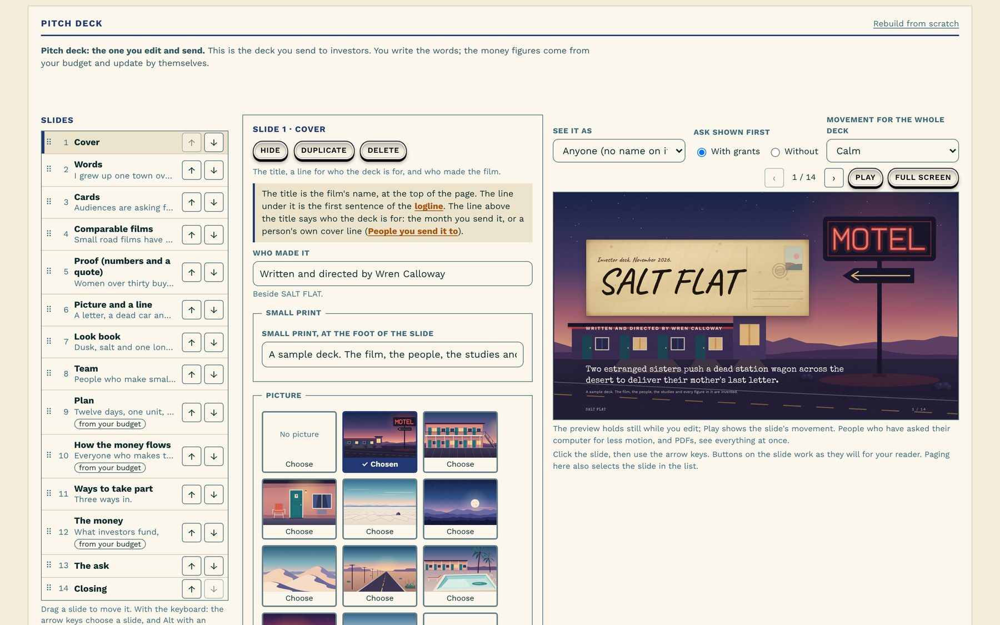

# ProfitShare

Open-source budgeting, scheduling and profit-share modelling for independent films.

Commercial budgeting software stops at what you pay up front. ProfitShare is for films where part of everyone's pay is a share of the back end, the way *Sing Sing* was made: everyone takes scale up front, and the upside is split by points. Every budget line carries a pay type:

- **Up front**: what you have to raise.
- **Deferred**: a fixed IOU, paid out of the film's first proceeds.
- **Points**: a share of the back end, worth something only if the film makes money.

The top sheet, the SAG-AFTRA tier check, the schedule and the points schedule all read the same lines, so moving a producer's fee to points, or dragging a scene to another day, reprices the whole film at once.

Written by a director budgeting her first feature, because none of the tools would let her model the deal she was actually making.

**Use it now: https://profitshare.alonegirlmovie.com/** (nothing to install, no account). Press *Load the sample* to look around an invented film, *Salt Flat*. *Take the tour* walks you through the sample in a few steps, and the glossary on the About page explains the money words (waterfall, recoupment, deferred, points) in plain English.



*The Deal tab, with the sample's producer fees moved to points. Every screenshot here is the invented sample.*

## What it is and what it is not

- **Built by a filmmaker, not a lawyer or a C.P.A.** ProfitShare is a tool to get you 90% of the way to the finish line. It is up to you to show your work to your legal team and your C.P.A. before and during your contract and negotiation period.
- **US dollars, California rules.** Payroll fringes (the taxes and fees an employer pays on top of a wage) default to a California set, and the state incentive it models is the California film tax credit.
- **SAG-AFTRA low-budget theatrical tiers.** Ultra Low Budget, Moderate Low Budget, Low Budget and Theatrical Basic, with the rates effective 7/1/2026.
- **Built for a laptop screen.** It opens and works on a phone, where the widest tables scroll sideways inside their own box, but budgeting is easier with room. The pitch decks it makes are laid out for phones too.
- **Not legal, tax or financial advice.** It does not replace a payroll company, a SAG-AFTRA signatory rep or an attorney. Check the numbers with them before anyone signs.
- **About the decks.** The money slide of a deck carries a line saying the figures are illustrative and not a promise of returns. Sending a deck to potential investors can be subject to securities rules, so have a lawyer look before you send.

## Privacy

Your projects live in your browser and in the `.json` file you save. There are no accounts, there is no server, and nothing is uploaded. Clearing your browser's site data removes any project you never saved to a file, so press *Save* for anything you want to keep. ProfitShare reminds you when a project has changes that are not in a file yet, and *Download all my projects* on the start screen puts every project in this browser into one `.zip`.

Two things contact the network, and only when you ask:

- **AI assist (optional).** It is off until you paste your own Anthropic API key, which is kept in this browser and never in the project file. The key is not encrypted; use one with a spending limit. Each AI button says what it sends before it sends it, and the request goes from your browser straight to Anthropic. *Draft* on the Pitch tab sends a short brief of your pitch and figures, plus any PDFs you added for it to read. *AI breakdown* on the Stripboard sends the scene text, the cast list and the tag names in use. Nothing is applied until you accept it.
- **The Google Fonts picker (optional).** It asks first. If you agree, font previews and the font you pick are fetched from Google, which sees your computer's address and which fonts you look at, and nothing about your project. The picked font is saved into the project, so a deck you send never needs Google.

The app page carries a Content-Security-Policy that lets it talk only to itself, `api.anthropic.com` and the two Google Fonts hosts.

## What it does

### Start a budget

The start screen has four ways in:

- **From a script.** Drop a screenplay (Final Draft `.fdx`, Fountain, plain text, or a PDF with real text in it). ProfitShare breaks it into scenes, schedules it at your pages per day and draws a first budget around it. Every line says how it was sized. It is a starting place, not a quote.
- **From scratch.** An empty budget with a standard feature chart of accounts and California fringes.
- **Import a budget.** A Shamel Studio `.xlsx` export, a Movie Magic Budgeting Excel or CSV export, or any spreadsheet with Account, Description, Amount, Units, X, Rate and Total columns. A Movie Magic Scheduling `.sex` board can be dropped too.
- **Open or explore.** Open a saved `.json`, or load the sample: *Salt Flat*, an invented 12-day, 26-scene SAG feature with a 154-line budget. Every name and number in it is made up.

Every project is autosaved in the browser; *Save* downloads it as one `.json` file to keep or hand to a collaborator. *Download all my projects* saves every project in this browser as one `.zip`, and a reminder appears when a project has changes you have not saved to a file.

### Set the deal

The Deal tab holds every term in one place, as a layer over the budget. The budget you brought in is never rewritten, and any term can change at any time.

- Shoot days, a 10- or 12-hour day, the SAG-AFTRA tier, and DIC (the Diversity in Casting incentive, which raises the budget cap on two of the tiers).
- How people are paid: as budgeted, or everyone at scale (the *Sing Sing* deal).
- What happens to producer fees, the script purchase and star allowances: up front, points, deferred, or gone.
- Prep, wrap and post days at a floor rate, with the balance going to the back end.
- Where you shoot, grants and a fiscal sponsor's fee, and the waterfall.
- A table that prices the film at every SAG tier under each pay model.

### Budget

- A top sheet (the one-page summary of a budget by category) over a chart of accounts you can edit.
- Each line is amount × rate, with fringes on top, and a pay type you can change in place. Where the Deal tab sets the pay (producer fees, the script purchase, star allowances), the line says so and links to the control that sets it.
- Up front, deferred and points totals sit side by side. Lines the deal sets are marked.
- Print the top sheet or the full budget.
- Export for someone who does not use ProfitShare: an Excel workbook (the top sheet, every line, the points schedule and the deal terms), a CSV of the budget lines for other budgeting software, or a PDF of the top sheet and full budget. The PDF prints Latin, Greek and Cyrillic letters; Chinese, Japanese, Korean, Arabic and Hebrew still come out as question marks.

### Schedule

- **Stripboard.** One strip per scene. Drag to reorder, place day breaks by hand, break at a pages-per-day target, or fit to a number of days. Split a scene across two days. A day-out-of-days (who works on which day) comes with it.
- Cast work days flow from the board into the cast lines of the budget and the points schedule on their own.
- **Tagging.** Open a strip to read the scene and tag props, vehicles, animals, stunts, effects and the rest. Imported scripts get an automatic first pass.
- **Calendar.** Put shoot days and other events on real dates, skip US holidays, stamp the dates onto the board, export `.ics`, and print sides for a day.

### Points and the waterfall

A waterfall is the order in which money that comes in gets paid out. Recoupment is investors getting their money back, usually with a premium, before or while everyone else shares.

- Two models: recoup first, or off the gross, where the cast and crew pool takes a share from the first dollar.
- Points are days worked × a tier multiplier, with an optional bonus or a fixed block.
- Payouts at three revenue figures, the investor multiple, what one point is worth, and each person's wages beside their points.
- Deferred pay comes off the top before the split. Grants are never repaid.
- *Add position* makes the wage line and the person on the schedule in one go. A position can follow the cast or a tag on the board (a wrangler on every day the animal works).

### SAG tier check

Total production cost the way SAG-AFTRA measures it (deferred pay counts, points do not), checked against each tier's cap, with and without DIC.

### Incentives

Credits and perks are switches. They do not change what the film spends; they reduce what investors have to put in.

- The California Film & Television Tax Credit (Program 4.0), figured from the budget, with the cost of turning it into cash and the application window that fits your start date.
- A proposed federal credit. It is a bill, not a law, and the tab says so.
- California fee waivers and exemptions as a checklist.

### Call sheets and breakdowns

- **Call sheets.** One per shoot day, front and back, drawn from the board, the calendar and the points schedule and edited in place. Sunrise and sunset come from the location's coordinates with no network. Print one day or the whole run.
- **Breakdowns.** Story days by shoot day, by character, by department, or one element across the schedule. Print any of them.

### Pitch

- **Write the pitch.** Logline, the case, the audience, comparable films, and three revenue cases run through your waterfall. *Print* gives an investor summary.
- **Look book.** Pictures, or the pages of a PDF, resized and kept inside the project.
- **Design.** Your colours, type and logo, read from a brand book PDF or built from your own pictures. Fonts from Google Fonts or your own font files.
- **Research and team.** Findings with their sources, and the people attached.

**The pitch deck builder** drafts a deck from what the tab holds, then it is yours to reorder and edit beside a live preview.

- Fourteen kinds of slide: cover, picture and a line, look book, words, cards, proof (numbers and a quote), comparable films, team, plan, how the money flows, ways to take part, the money, the ask, closing.
- The plan and money slides read the budget, the schedule and the deal. A number with no source is left off.
- Cards are drawn on a paper you choose (plain, postcard, letter, notebook, torn page, or a mix) in a shade you choose (your own card colour, white, cream, aged, kraft, newsprint).
- Slides can move, from a fixed set of choices. It is off until you add it.
- **People you send it to.** Each gets a cover line, a note and a file of their own that names nobody else.
- **Send it.** A web deck (one `.html` that opens offline, with funding switches that work, and a strict security policy that loads nothing from outside) and PDFs, one set per person, or everything in one `.zip`. The files hold only what the deck shows: no budget lines, no other people, no hidden slides.
- With your own key, optional helpers suggest a line for a person, propose movement, or read the deck for problems. Each is a proposal you apply or discard.

## Screenshots



*The start screen, with its four ways in.*



*The top sheet. The two producer fees are marked "deal" because the Deal tab moved them to points.*



*The stripboard, with day breaks and the day table.*



*Points & waterfall: who gets what at three revenue figures.*



*The pitch deck builder: slides, the editor and the live preview.*

## Browsers

Every pull request is tested in Safari's engine (WebKit), Firefox and Chromium by the workflow in `.github/workflows/browsers.yml`.

## Run it locally

Needs Node 22.12 or newer, which is what the workflows run.

```bash
npm install
npm run dev            # http://localhost:5173
npm test               # the engine and UI tests
npm run build          # static site in dist/ (the GitHub Pages workflow deploys this)
npm run preview        # serve dist/ locally
npm run build:single   # one self-contained index.html in dist-single/
npm run sample         # rebuild the sample project and the importer fixtures
npm run browsers       # walk the built app and a sent deck in one engine (BROWSER=webkit, firefox or chromium)
npm run deck:scratch -- deck.json out.html   # a test page from a deck JSON
npm run fonts:catalogue      # rebuild the bundled list of Google Fonts families
```

The Pages workflow in `.github/workflows/pages.yml` builds and deploys on every push to `main`. To host your own copy, turn on Pages in the repo settings with *Source: GitHub Actions*.

## How it's built

React, Vite and TypeScript. It is a static site: everything runs in the browser.

```
src/engine/            pure TypeScript, no React: budget math, the deal layer (deal.ts), SAG tiers,
                       waterfall, board, call sheets, incentives, the deck's data, importers
src/engine/*.test.ts   vitest
src/deck-runtime/      the pitch deck renderer: no framework, no network
src/data/              the sample project, the standard chart of accounts, the Google Fonts list
src/ui/                React views
tools/                 make-sample.mjs (builds the sample and its fixtures), the browser walk (browsers.mjs), fixtures
```

`src/engine/types.ts` is the whole data model. A project file is that object as JSON, so anything that can read JSON can read a ProfitShare project.

The deck preview in the app and the web deck you send are the same renderer, bundled once, so what you see is what you send. PDFs are written in the browser with pdf-lib; screenplay PDFs are read with pdf.js. Spreadsheets are read by the app's own small reader.

<details>
<summary>Importer notes</summary>

- **Budgets.** The spreadsheet importer (`src/engine/importers/genericBudget.ts`) matches columns by header name and treats rows with a number and a name but no money as account or category headers, which is the shape Movie Magic Budgeting exports. Weekly crew wage lines come in as days (five to the week, same money). Rows that carry no money are folded into a note on the line they belong to.
- **Boards.** The `.sex` reader was reverse-engineered from a Shamel Studio export (there is no public spec). It keeps strip order and breakdown tags. Movie Magic's native `.mbd` is a closed format and is not read; export to Excel or CSV first.
- **Scripts.** One parser (`src/engine/importers/screenplay.ts`) reads Fountain, plain text and the positioned lines pdf.js pulls out of a PDF. A Final Draft `.fdx` keeps its scene numbers and any tags made in Final Draft's tagger. A scanned PDF has no text to read, so export the PDF from the writing app instead.
- **Merging.** Drop a script on a project that already has a board and ProfitShare offers to merge it: scenes match by number, and your day breaks, strip order and tags stay. Replacing the board asks first and keeps the old one for Undo.
- `tools/fixtures/` holds the test files, all invented.

If a file from another app fails to import, open an issue and describe it. Please do not attach a real budget.

</details>

## Rates and disclaimers

- **SAG-AFTRA.** Day rates are the 7/1/2026 figures: Ultra Low $257, Moderate Low $449, Low Budget $834, Theatrical Basic $1,321. Caps are $300,000, $700,000 ($1,050,000 with DIC) and $2,000,000 ($3,750,000 with DIC). The low-budget rates rise 3% every July through 2030. Pension and health (P&H) is 22% from 9/6/2026.
- **Fringes.** The default California 2026 set: FICA 7.65%, FUI 0.6% and CA SUI 6.2% on the first $7,000 per line, workers' comp 4.48%, payroll fee 1.75%, SAG-AFTRA P&H 21% for principals. The SAG tier tab tells you when the budget's P&H rate and the tier's disagree. Change any of them in the Fringes panel under the top sheet.
- **California credit.** 35% base, plus the out-of-zone, local-hire, VFX and trainee uplifts, on the first $20M of qualified spend. Sources and check dates are in `src/engine/incentives.ts`.

These numbers move. None of this is legal, tax or financial advice. Check the numbers with your payroll company, your SAG-AFTRA signatory rep and your attorney before anyone signs.

## Roadmap

Not built yet:

- A participation-agreement exhibit generated from the points schedule
- Movie Magic Budgeting native `.mbd` files (needs a sample; the Excel and CSV exports already import)
- Reading notes for a sent deck ("who opened it"), planned as a collector you host yourself
- An installable version that works offline

## Contributing

[CHANGELOG.md](CHANGELOG.md) is kept by day, newest first, so you can see what changed and why before you start. Issues and pull requests are welcome. Engine changes need a test; the sample budget must still total $805,312.06 and round-trip through the importers.

[CONTRIBUTING.md](CONTRIBUTING.md) has how to run the checks and the rules a change has to keep. [SECURITY.md](SECURITY.md) says how to report a security problem privately. [docs/file-format.md](docs/file-format.md) covers the project file and the rule for changing it, and [docs/rates.md](docs/rates.md) lists every rate and dated rule to check each year.


## Support

ProfitShare is free and open source. If it helped your film, [the tip jar](https://buy.stripe.com/00wbJ00wP1KC1ich08asg01) helps with its upkeep and with getting *ALONE GIRL*, the film it was built for, made. Tips are gifts and are not tax-deductible; your statement will show BLISSFULSPINSTER.COM.

## License

MIT © 2026 Cris Graves

Noto Sans, in `src/assets/fonts/noto-sans/` and used in budget PDFs, is under the SIL Open Font License 1.1. Its licence is beside the font files.
